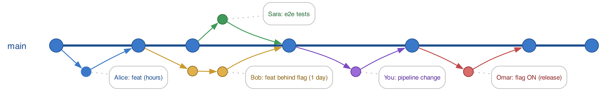
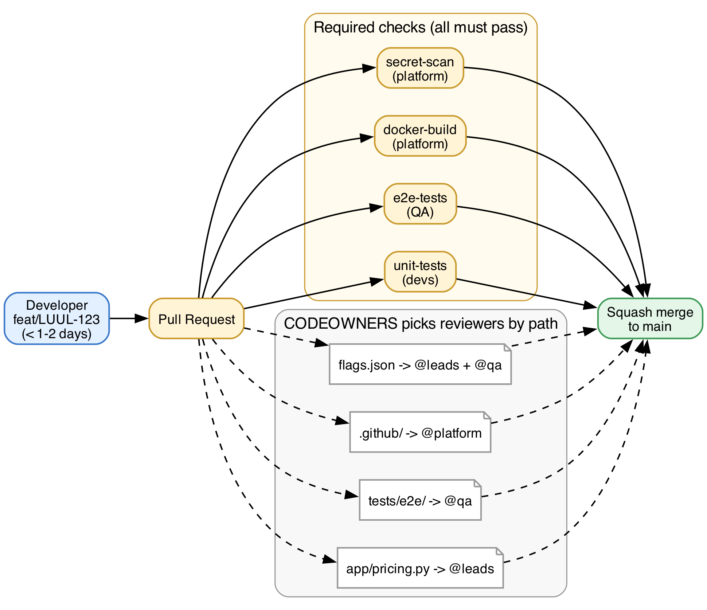
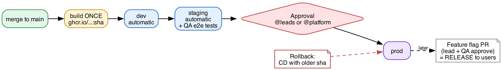

# luul-orders-service: trunk-based delivery platform

A reference implementation of **trunk-based delivery for a multi-role engineering team** (developers, QA, lead engineers, platform). It covers the whole path from a pull request to production: role-based access, required checks, environment-gated promotion, feature flags, GitHub-as-code with Terraform, and tested incident runbooks.



## Highlights

- **Trunk-based workflow:** short-lived branches, squash merges, linear history, and feature flags that separate *deploy* from *release*
- **Role-based guardrails:** GitHub teams with least privilege, CODEOWNERS per path, and a ruleset protecting `main` (PR required, code-owner review, 4 required checks, no force-push)
- **CI on every PR:** `unit-tests`, `e2e-tests`, `docker-build`, `secret-scan` (gitleaks), plus merge-queue support
- **CD with promotion:** build once, tag the image with the commit SHA, then dev → staging (QA e2e against the running container) → **prod behind lead/platform approval**
- **Rollback by SHA:** redeploys an earlier commit with *its own* code, tests and environment settings
- **GitHub as code:** teams, memberships, repo permissions, ruleset and environments in **Terraform**, with zero drift on re-plan
- **Supply chain and secrets:** push protection, gitleaks allowlist policy, pre-commit hook, Dependabot, non-root container image
- **Incident drills:** 10 reproducible scenarios (broken trunk, leaked credential, regression bisect, release hotfix and more) with tested runbooks

## Architecture

| Pull request flow | Environment promotion |
|---|---|
|  |  |

**Roles and access** ([docs/ROLES.md](docs/ROLES.md))

| Team | Repo role | Owns / approves |
|---|---|---|
| `developers` | Write | `app/`, unit tests |
| `qa` | Write | `tests/e2e/`, feature-flag releases (with leads) |
| `leads` | Maintain | `app/pricing.py`, flag releases, **prod deployments** |
| `platform` | Admin | `.github/`, `platform/`, `deploy/`, `Dockerfile`, **prod deployments** |

## Repository layout

| Path | Purpose |
|---|---|
| `app/` | Orders/pricing HTTP API (`/health`, `/version`, `/price`, `/orders/summary`) |
| `config/flags.json` | Feature-flag defaults for every environment |
| `deploy/<env>.env` | Per-environment settings and flag overrides |
| `tests/unit/`, `tests/e2e/` | Unit tests (developers) and end-to-end API tests (QA) |
| `.github/workflows/` | `ci.yml` (PR checks), `cd.yml` (promotion + rollback), `release.yml` (tags → releases) |
| `.github/CODEOWNERS` | Path-based review ownership |
| `platform/terraform/` | GitHub org/repo configuration as code |
| `platform/setup-org.sh` | The same setup with the GitHub CLI |
| `scripts/install-hooks.sh` | Pre-commit hook: blocks commits on `main`, secrets, large files |
| `sim/` | Incident drills: a simulated 5-person team and 10 scenarios |
| `.gitleaks.toml` | Secret-scan policy (allowlists the drill fixture only) |

## Quick start

```bash
make test        # unit + e2e
make run         # http://localhost:8080/price?amount=100&code=LUUL10
make build       # container image tagged with the commit SHA
make hooks       # install the pre-commit hook
```

Provision the GitHub guardrails (sandbox org):
```bash
cd platform/terraform
cp terraform.tfvars.example terraform.tfvars   # org + team members
terraform init && terraform plan && terraform apply
```

Roll back production to an earlier commit:
```bash
gh workflow run CD -f sha=$(git rev-parse <good-sha>)
```

## Documentation

- [docs/ROLES.md](docs/ROLES.md): roles, permissions and how they are enforced
- [docs/GITHUB-MODE.md](docs/GITHUB-MODE.md): GitHub setup and operational notes
- [docs/DEVELOPER-VIEW.md](docs/DEVELOPER-VIEW.md): developer workflow and cross-team troubleshooting
- [docs/SCENARIOS.md](docs/SCENARIOS.md): incident drills and runbooks
